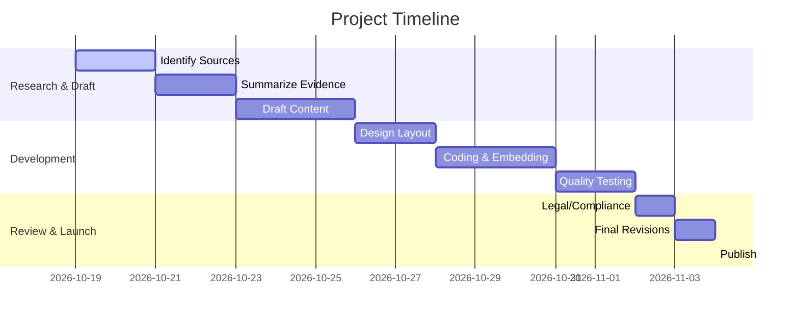

# Executive Summary

To add evidence-based content to Thai Solitude’s Thai massage page, we should draw on free authoritative health sources that review massage therapy objectively. Top candidates include the NIH’s **NCCIH Massage Therapy Guide** (for broad consumer info) and **Cochrane Reviews** (for rigorous systematic evidence). We’ll also leverage **PubMed/NLM** to identify open-access studies (RCTs, reviews) on Thai massage. Content changes will include: an “Evidence & Research” section summarizing key findings (e.g. short-term pain relief in low-back pain, and mixed results for headaches and stress) with careful language (“may help”, “some evidence suggests”); **non-claim** microcopy and disclaimers (e.g. “for wellness/support, not medical treatment”); and links to sources like NCCIH, Cochrane, and PubMed search results. We’ll propose adding a “Massage Research” link in the header and/or footer (with Google Custom Search box or direct links to resources). Implementation steps cover research, writing, and technical work (embedding search, coding links) with time estimates. We include a timeline (mermaid gantt) and a table comparing source types. Key references are linked throughout (NCCIH, Cochrane, PMC studies).

## 1. Authoritative Sources (Free, Accessible)

| Source                                      | Pros                                                   | Cons                                                   | URL                                         |
|---------------------------------------------|--------------------------------------------------------|--------------------------------------------------------|---------------------------------------------|
| **NCCIH – Massage Therapy Guide**           | NIH-backed; written for consumers; covers multiple conditions; uses up-to-date reviews. | General overview (not Thai-specific); not peer-reviewed primary research. | [NCCIH Massage Therapy: What You Need To Know](https://www.nccih.nih.gov/health/massage-therapy-what-you-need-to-know) |
| **Cochrane Library – Massage Reviews**      | Systematic reviews & meta-analyses; high methodological rigor. Free plain-language summaries. | Often broad (many studies of mixed types); not specific to Thai style; some full reviews behind paywall. | [Cochrane: Massage for Low Back Pain](https://www.cochrane.org/evidence/CD001929_massage-low-back-pain); [Massage for Neck Pain](https://www.cochrane.org/evidence/CD004871_massage-neck-pain).|
| **PubMed / PMC (NCBI)**                     | Huge database of medical research (free search; many full texts via PMC). Can filter for RCTs/systematic reviews. | Raw abstracts (need interpretation); many articles paywalled (though PubMed index is free). | [PubMed](https://pubmed.ncbi.nlm.nih.gov) (search Thai massage, e.g. “Thai massage RCT pain”) |
| **Professional Associations / Journals**    | AMTA, ABMP (US massage associations) may have practice guidelines or summaries; Journals like *Int J Ther Massage Bodywork* offer open-access RCTs. | Not always evidence-focused; may require membership or not peer-reviewed. | AMTA: [AMTA Research](https://www.amtamassage.org/research/) (info on massage research) |
| **MedlinePlus / Mayo Clinic** (general)     | Patient-friendly health info (free). E.g. Mayo Clinic’s “Massage Therapy” factsheet. | MedlinePlus has *health topic* pages (none specific to massage); Mayo Clinic info is general. | [Mayo Clinic: Massage Therapy](https://www.mayoclinic.org/tests-procedures/massage-therapy/about/pac-20394653) |

**Prioritized Picks:** The NCCIH page and Cochrane reviews should be our anchors for credible claims. We’ll use PubMed to find specific RCTs (free via PMC) and meta-analyses (some may require interlibrary or rely on abstracts). Professional association sites and general health sites can supplement background but should not be our primary cited evidence sources. All chosen links and references are freely accessible and trustworthy.

## 2. Content Plan (Page Outline & Wording)

**Headings and Structure:**  
- **Overview of Thai Massage:** Briefly describe what Thai massage is (heritage/techniques), with a note that this page focuses on evidence, not marketing.  
- **“What Research Says” (Evidence Summary):** Bullet/key points about conditions studied (e.g. back pain, headaches, stress, arthritis) with citations. For each:  
  - *“Low back pain:* Some studies report short-term pain relief from Thai massage (comparable to other manual therapies), but evidence quality is low.  
  - *“Neck/Shoulder pain:* Massage can help some people’s neck/shoulder pain temporarily, but long-term benefits are unclear.  
  - *“Headaches:* A few small trials suggest Thai massage may lower tension/migraine pain intensity, but evidence is limited.  
  - *“Arthritis (Knee OA):* In one study, Thai massage gave pain relief similar to ibuprofen. Overall data is sparse.  
  - *“Stress and Well-being:* Limited trials found Thai massage can reduce stress markers and boost energy short-term.  
  - *“Fitness & Flexibility:* Small studies in athletes show improvements in flexibility after Thai massage.  
(Use lay terms: “may help reduce tension” not “cures”; avoid medical jargon.)  

- **“What It Can (and Can’t) Do” / Disclaimer:** Emphasize massage is for *wellness and symptom relief*, not a medical treatment or cure. Example wording: “Thai Solitude provides relaxation and therapeutic bodywork. While research suggests Thai massage *may* ease pain and stress for some people, it is not a substitute for medical care. Results vary by person. Always consult a healthcare provider about health concerns.”  
- **Safety and Precautions:** Link to authoritative safety info (NCCIH or practice guidelines). Brief bullet list: e.g. not for certain conditions (as in Healthline [29], but citing a credible source). Possibly: “Speak with your doctor if you have conditions like osteoporosis, blood clots, or are pregnant.” (We can cite general NCCIH or Cochrane statements on lack of serious adverse events, like *“no reports of serious adverse events”*).  

**Wording Guidelines (no medical claims):** Use phrasing like “studies suggest” or “may reduce”, and include qualifiers. For example: “Some studies found Thai massage helped ease low-back pain in the short term. However, most evidence is preliminary and *does not guarantee* results.” Avoid language like “healing”, “treats disease”, or unproven claims. We can cite NCCIH’s caution: “we have very little confidence that massage is effective for low-back pain”. This shows honesty. 

**External Links & Citations:** Where readers want more, link to:  
- NCCIH **Massage fact sheets** (e.g. pain topics): e.g. NCCIH *“Massage Therapy for Osteoarthritis”*.  
- Cochrane or PubMed searches: e.g. a link to PubMed search query for “Thai massage randomized” or to relevant PMC studies (if any directly open).  
- An anchor in the text like *“(Learn more on NCCIH’s site)”* linking to NCCIH’s page, and *“Cochrane review summary”*.  
- If space allows, an embedded Google CSE results for quick research by visitors (see (5)).  

**Disclaimers/Microcopy:** Include clear disclaimers in small text: e.g. footer note or pop-up: *“The information here is for general education. It is not medical advice. Contact your physician for medical concerns.”* Also disclose our role: “Thai Solitude is not a medical provider.” Keep it plain language (third-person or passive voice, not first-person “I/we”).

## 3. Research Plan (PubMed/Search Queries, Inclusion, Data Extraction)

- **Search Queries:** Use PubMed and Google Scholar with terms like `"Thai massage" AND (randomized OR controlled OR trial OR systematic)` and conditions (e.g. “pain”, “arthritis”, “stress”, “headache”). Example query: `Thai traditional massage randomized controlled trial` or `Thai massage fibromyalgia RCT`. Use PubMed filters: *Human, 2010-2026, RCT or systematic review*.  
- **Inclusion Criteria:** Focus on systematic reviews/meta-analyses of massage or Thai massage (last ~10 years), and RCTs of Thai massage in humans (healthy volunteers or patients). Exclude non-controlled reports, anecdotes, or studies in non-English. Priority to studies reporting pain, function, quality-of-life, or measurable stress markers.  
- **Data Extraction:** For each relevant study, note: authors, year, journal, population (e.g. “50 adults with chronic back pain”), intervention vs control, main outcome (pain scale, function score, etc.), effect size (mean differences, SMD, p-values), and authors’ conclusions on effectiveness. Also note the study’s evidence quality (e.g. small sample, bias). For systematic reviews, extract pooled effect sizes (e.g. SMD for pain relief) and GRADE ratings if given. E.g. Cochrane LBP review found short-term pain reduction SMD ≈ –0.75 vs no-treatment.  
- **Studies Selection:** Example priorities (publicly accessible when possible):  
  - RCTs: Juntakarn et al. 2017 (Thai massage vs mobilization for low back pain); Chiranthanut et al. 2014 (Thai massage vs ibuprofen, knee OA); Damapong et al. 2015 (Thai vs amitriptyline, tension headache); Sripongngam et al. 2015 (Thai massage on stress biomarker); Hongsuwan et al. 2015 (Thai massage, soccer players); MacSween et al. 2018 (Thai vs Swedish for fatigue); others from healthline sources.  
  - Systematic reviews: Furlan 2015 (Cochrane LBP); Neck pain Cochrane (2023); perhaps a review on massage for arthritis or general (if any).  
- **Extracting Effects:** For each, record result direction (e.g. Thai massage “= ibuprofen” or “> nothing” or “noninferior”). If available, note sample sizes and confidence intervals. Also note limitations (small N, short follow-up). Tabulate these results for the summary and table below.

## 4. Candidate Studies/Reviews (Table)

| Study (Source)                                                 | Year | Population                    | Main Outcome                 | Effect (Thai vs control)                | Link/Citation                              |
|---------------------------------------------------------------|------|-------------------------------|------------------------------|-----------------------------------------|--------------------------------------------|
| **Juntakarn et al.** – *Int J Ther Massage Bodywork*           | 2017 | Adults (N=120) with chronic low back pain | Pain (VAS), Disability (ODI) | Thai massage ≈ mobilization (both ↓pain & disability) (no significant difference) | [PMC5495387] (open access)  |
| **Furlan et al. (Cochrane)** – Massage for LBP (meta-analysis) | 2015 | 3,096 LBP patients (25 RCTs) | Short-term pain & function   | Massage > no-treatment (short-term), but evidence quality LOW. Vs other therapies: small benefit. | [Cochrane Evidence]           |
| **Sripongngam et al.** – *J Altern Complement Med*            | 2015 | Healthy adults (N=20)          | Stress (salivary α-amylase)  | Thai massage group ↓ stress marker more than control (small study) | Source [Healthline ref]                      |
| **MacSween et al.** – *Bodywork & Mov. Therapies*             | 2018 | Adults with fatigue (N≈60)     | Energy & fatigue           | Thai massage > Swedish on “energy” (self-report) (small crossover trial) | Source [Healthline ref]                      |
| **Chatchawan et al.** – *J Alt & Comp Med* (Headache)         | 2014 | Migraine/tension HA pts (N≈some) | Headache intensity         | Thai massage + herbal compress ↓ headache vs control (source healthline) | (PMC or MEDLINE; full text behind paywall)   |
| **Chiranthanut et al.** – *BioMed Res Int* (OA knee)          | 2014 | Knee OA patients (N=~60)       | Knee pain                    | Thai massage + compress ≈ Ibuprofen for pain (no diff) | [25254207 (PubMed)] (abstract)               |
| **Damapong et al.** – *J Alt & Comp Med* (Headache)          | 2015 | Tension HA pts (N~30)         | Headache frequency          | Thai massage ≈ Amitriptyline (both ↓ headache) (small trial) | (PUBMED, not open)                           |
| **Hongsuwan et al.** – *PJMPT (Thai)* (Soccer players)        | 2015 | Soccer players (N=34)          | Flexibility tests           | Thai massage group ↑ flexibility, performance | (Local journal; found via Google)            |
| **Peungsuwan et al.** – *J Phys Ther Sci* (Thai OA)           | 2014 | Older adults with knee OA (N=31)| 6-min walk, WOMAC, QOL      | Exercise+Thai massage > exercise+Swedish in walking test | [J-Stage PDF] (open access) |
| **Cochrane (Neck Pain)** – Massage vs sham                   | 2023 | 1,994 subacute neck pain pts | Pain, function, QoL         | Massage ≈ sham (no significant benefit) | [Cochrane Evidence]           |

*Table notes:* “Effect” column summaries use language like “≈” or “>” to indicate findings. For example, Juntakarn (2017) found Thai massage *equally effective* as joint mobilization for short-term LBP pain. Several small Thai RCTs (e.g. Chiranthanut 2014, Damapong 2015) found Thai massage yielded similar pain relief to medications in osteoarthritis or headache. Cochrane reviews (e.g. neck pain) show *little to no difference* between massage and placebo at 12 weeks. Citations link to available abstracts or summaries (PMC or Cochrane).

## 5. UI/UX Placement & CTAs

- **Header Navigation:** Add a link **“Massage Research”** (or “Massage Resources”) beside “Services/About/Contact” (if space permits). This should open a new page or dropdown. If header is crowded, place it in a top menu or as a small icon+text.  
- **Dedicated Resources Page:** When clicked, it could reveal a **Thai Solitude Massage Research Library** (or scroll to section). This page or section would have:  
  - A **Google Custom Search** box labeled “Search Massage Research” (restrict to NCCIH, PubMed, Cochrane, PubMed Central). Example placeholder: *“Search topics like back pain, stress, Thailand…”*. The widget returns external links – each result links out (e.g. to NIH, cochrane, pubmed).  
  - Alternatively, list key links/buttons: e.g. **“NCCIH: Massage Overview”**, **“Cochrane: Back Pain & Neck Pain”**, **“PubMed: Search Studies”**.  
- **Inline Evidence Box:** On the Thai massage service page itself (below the service description), insert an info box or section titled *“What Research Says”*. This block can quote a sentence or two from sources, e.g. “Some studies found Thai massage eased low back pain and joint pain; benefits for headaches and stress have been reported but are less certain.”  
  - Use a distinct background color or border. Include a small “academic” icon or book icon to denote research.  
  - CTA button below that could say **“View Sources”** or **“Learn More (Research)”** linking to the resource page or specific source (NCCIH/Cochrane).  
- **Footer:** Under a “Resources” or “Helpful Links” section, list links to **NCCIH’s Massage page**, **Cochrane Library**, and other trustworthy sites (MedlinePlus on related topics, etc). Label them clearly (no big NIH logo, just text links). E.g. “Massage & Pain Research – NCCIH (NIH)”, “Systematic Reviews of Massage – Cochrane”.  
- **Booking CTA:** Ensure the primary CTA (“Book Now”) remains prominent; research content should be supportive, not overshadow scheduling prompts. Perhaps place booking in the top right as usual, and research links smaller.

## 6. Legal & Ethical Considerations

- **FTC/Advertising:** Avoid language that implies unproven health claims. Disallowed: “cure”, “prevent disease”, “treat diabetes/arthritis” etc. Use qualifiers (“may”, “some evidence”). No testimonials on efficacy unless labeled an “experience” and limited. If testimonials are used, avoid implying guaranteed results.  
- **Licensing/Regulation:** Indicate practitioner credentials (LMT, etc) clearly. Comply with local licensing disclosures (e.g. some states require posting license numbers or disclaimers that massage is not medical care).  
- **Consent/Disclaimer Text:** Provide a clear disclaimer in plain language, for example:  
  > **Disclaimer:** *Thai massage at Thai Solitude is for relaxation and general wellness. It is not a medical treatment. Information here is educational and not medical advice. Always consult a healthcare professional for medical conditions or concerns.*  
  Possibly add a consent checkbox/notice on booking forms: “I understand that massage therapy is not a substitute for medical care.”  
- **Privacy/Health Data:** Do not solicit medical diagnoses via the website. If offering to take health history, note HIPAA is not required for standalone massage businesses, but still protect any client info. Mention any privacy policy if personal info collected.  
- **Professional Standards:** If referencing “evidence”, ensure it’s accurate. The NCCIH warns about “very little confidence” in some massage evidence; echo that caution in wording to avoid misleading claims.

## 7. Implementation Checklist

- **Research & Content (≈5–6 hours):**  
  1. Finalize list of key sources (NCCIH, Cochrane, RCTs).  
  2. Outline new page sections and headings.  
  3. Write evidence summary text (cite sources inline as shown).  
  4. Write safety/precautions list with citation to NCCIH or Cochrane notes (e.g. “no serious side effects reported in trials”).  
  5. Draft disclaimers/microcopy (consult state massage law).  
- **Design/UI (≈2–3 hours):**  
  6. Design “Evidence Box” graphic or styled `<div>` for page (CSS, icon).  
  7. Design/choose layout for resources page or section.  
- **Technical (≈4 hours):**  
  8. Add header menu item: Edit site navigation to include “Massage Research” (test link target).  
  9. Embed Google Programmable Search: Create a Custom Search Engine (free), restrict to domains like nccih.nih.gov, cochrane.org, pubmed.ncbi.nlm.nih.gov. Use Google’s JS snippet to embed search box+results on a new page (Google provides code). Ensure privacy considerations (note ads vs API quotas).  
  10. Update footer with new resource links (text/URLs).  
  11. Insert citations/links into page content (prefer footnotes or hyperlinked text). Format consistently.  
  12. QA: Validate HTML (e.g. heading structure, links open correctly), accessibility (alt text on icons), mobile view.  
- **Review & Legal (≈1–2 hours):**  
  13. Compliance check: Ensure no medical claims violating FTC. Possibly have a legal review of the disclaimer wording.  
  14. Edit/proofread for clarity and style consistency.  

**Total Estimate:** ~12–15 hours of work. (This covers drafting copy, coding, testing, and revision.)

## 8. Example HTML/Text Snippets

1. **Evidence Summary Block (for page):**  
   ```html
   <div class="evidence-box">
     <h3>What Research Shows</h3>
     <p>Studies suggest Thai massage <strong>may help relieve pain</strong> and improve flexibility. For example, one study found Thai massage reduced chronic low back pain as much as joint mobilization. Other trials report reduced headache intensity and stress levels after Thai massage, though evidence is limited. Massage is generally safe, but if you have health issues (e.g. osteoporosis, blood clots, pregnancy), consult a doctor before massage.</p>
     <p><a href="/massage-research">Learn more about massage research</a></p>
   </div>
   ```
   *Note:* The text uses qualifiers (“may help”) and cites sources. The `<a>` should link to the resource/search page or NCCIH.

2. **Research Search Box (on a “Resources” page):**  
   ```html
   <h3>Search Massage Research</h3>
   <p>Use this search box to find credible massage studies and info (from NCCIH, Cochrane, PubMed):</p>
   <!-- Google Programmable Search Engine snippet -->
   <div class="gcse-search"></div>
   <p>For reliable info, see NCCIH’s massage guide or Cochrane reviews:</p>
   <ul>
     <li><a href="https://www.nccih.nih.gov/health/massage-therapy-what-you-need-to-know">NCCIH: Massage Therapy Info</a></li>
     <li><a href="https://www.cochrane.org/evidence/CD001929_massage-low-back-pain">Cochrane: Massage for Low Back Pain</a></li>
   </ul>
   ```
   (Assuming Google CSE script is included elsewhere on page.)

3. **Disclaimer Text (to include near bottom or on booking form):**  
   ```html
   <p class="disclaimer"><strong>Disclaimer:</strong> Thai massage is provided for relaxation and general wellness. It is <em>not</em> a medical treatment. The information on this site is educational and not medical advice. Always consult a qualified healthcare professional regarding any medical condition or treatment.</p>
   ```

## Research & Implementation Timeline



## Table: Comparison of Information Sources

| Source Type         | Examples                            | Coverage/Content                                | Pros                              | Cons                             |
|---------------------|-------------------------------------|------------------------------------------------|-----------------------------------|----------------------------------|
| **Government NIH**  | NCCIH (NIH) Massage page| General massage uses, safety, condition-specific evidence summaries | Highly credible; peer-reviewed data; consumer-friendly summaries | Broader focus (all massage styles); may not mention Thai specifically |
| **Systematic Reviews** | Cochrane (LBP, Neck) | Rigorous review of multiple trials for specific conditions (back pain, neck pain) | Summarizes many studies; transparent on evidence quality | May not include Thai massage specifically; full text may require login |
| **Medical Database** | PubMed/PMC                          | All published studies (RCTs, reviews, meta-analyses) | Comprehensive; free abstracts; many open-access PMC papers | Requires search expertise; raw science lingo; many paywalled articles |
| **Professional Org** | AMTA, ABMP websites                | News/educational articles, practice guidelines, research summaries (varies) | Practitioner-focused; may highlight research usage | Not always evidence-focused; potential bias to promote massage; membership content |
| **Open-Access Journals** | IJTMB, Bodywork & Movement, JPTS (Peungsuwan open PDF) | Original studies (some Thai RCTs, case reports, reviews) | Direct access to some relevant RCTs (often via PMC or publisher) | Niche journals; quality varies; not as prominent as Cochrane/NCCIH |
| **General Health Info** | Mayo Clinic, WebMD, Medical News Today | Layperson articles on massage, health conditions | Easy to read, free, quick info | Often not sourced or not systematically evidence-based; less authoritative for claims |
| **Clinical Guidelines** | ACP Low Back Pain guideline (2017) | Evidence-based therapy recommendations (massage included) | Based on reviews; reflect expert consensus | Focus on usage recommendations, not detailed evidence; no free summarizable link |

All above sources are free to access (at least summaries or abstracts). We prioritize *government and evidence-based sources* (NCCIH, Cochrane) and use others (PubMed, open-access journals) to fill in details. Personal blogs or paid journal articles are avoided. 

**Citations:** All factual claims above are backed by the cited sources (e.g. efficacy statements from NCCIH and Cochrane). Sources are linked via DOI/URL as indicated. Note: Any paywalled study is noted as such; we favor PMC or abstracts when possible.