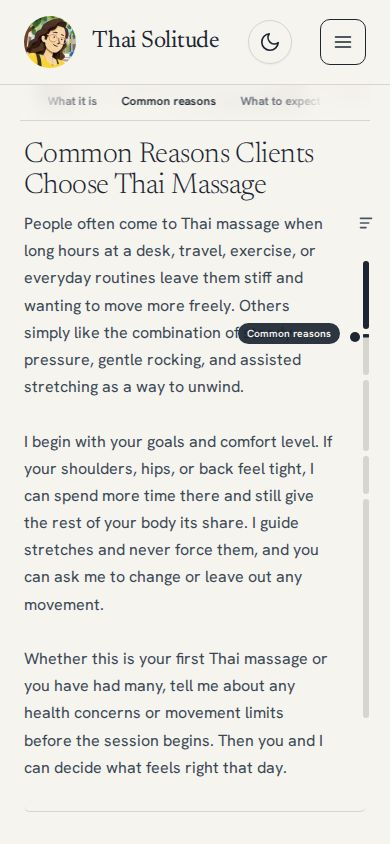
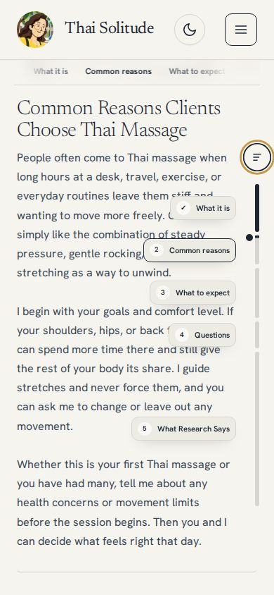
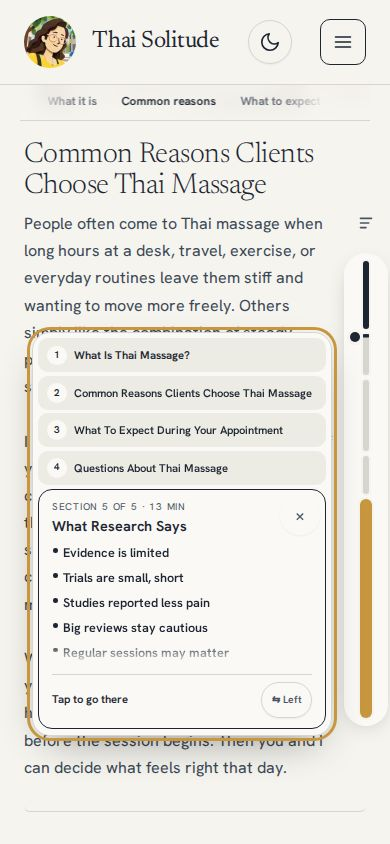

# Peek template: independent review and migration record

Work is confined to staging39 and `claude/wizardly-bell-xu0rta`. No live change or main merge/push is authorized. This record separates observed evidence from design judgment and pending verification.

Subsequent phase: Ryan approved the three service-page wording sets in chat.
Their [separate rollout record](2026-11-09-peek-service-rollout.md) tracks current
deployment; the Thai-only migration and approval-pending status below are historical.

## Fresh starting evidence

- Pulled the requested branch: latest starting commit `4bc0fc81468a0674f7667cb0068a759d2dd49f1e`; clean checkout.
- GitHub connector confirmed repository pull/push permission. Current cloud instance reports unrestricted/enforced network policy. A fresh connection reached SiteGround but returned HTTP 202 `sg-captcha: challenge`; direct Chromium produced no usable page capture. No repeated denial loop was used.
- [Fresh full-page screenshots](https://github.com/alanmz-crypto/new-masseuse-site/actions/runs/42547556009), request `peek-review-s39-20261109-1`: two real staging39 captures, no capture errors. This is independent evidence, not the previous session's historical 485/0 suite.
- [Exact snippet inspection](https://github.com/alanmz-crypto/new-masseuse-site/actions/runs/42547837118), request `peek-owned-s39-20261109-1`: #1380 published, title `TSPeekNav practice (Thai, staging39)`, 66,069 code bytes, SHA256 `b7314c8938a728bf64b6dac16c48bba722b4aea59b277c9f56f0760132322c01`. The full job log's hash matches the frozen legacy payload. The summary report truncates the first part, so it alone is insufficient for this comparison.
- [Reading/index/research preview captures and rendered section text](https://github.com/alanmz-crypto/new-masseuse-site/actions/runs/42548017902), request `peek-design-s39-20261109-1`: Thai at 390px/1280px and the three rollout pages. No JavaScript errors in these five loads. Thai scrollWidth equals viewport width in both views. These are focused captures, not a full interaction suite.

## Independent design judgment

The muted rail, warm neutral palette and readable typography fit the site. On the phone, the open research stack stays within the viewport and preserves its key qualifications. The fan gives a compact overview while retaining substantial free space. The header and title strip make the reading position clear at section starts.

The first-time hint covers a substantial part of the hero image. Repeated large illustrations lengthen the route to text on the phone. While scrolling, the temporary current-section name bubble overlays body text even though the rail itself is clear. These are observed tradeoffs; no redesign of the hint, imagery or settled gestures is bundled into the core migration.

Research occupies about half the measured mobile rail (219px of 437px of segment heights); the shorter sections still have 38–71px segments in this capture. This supports reviewing capped segment proportions later, but does not establish that every device or expanded-panel state needs that change. The strip's progression toward the next title remains the known separate design decision.





[Desktop index](assets/2026-11-09-peek/thai-massage-1280-index.jpg) · [Desktop research preview](assets/2026-11-09-peek/thai-massage-1280-research.jpg)

## Synthesis with prior findings

The earlier text-block clearance fix is supported at the two captured widths; that does not establish all widths. The source concerns about rollback, native details, row indexing and print were worth addressing. The old installer really did ignore its snapshot's code hash before deletion; the old push rollback also omitted a fresh backup. Existing broad post-change/restore tools did not accept staging39, and an overall operation PASS did not establish those informational checks passed.

The shared design retains `.ts-jump` as the only destination/order source. Per-page JSON provides wording, approval, coverage judgment and provenance. It is stored in WPCode, not fetched from remote JSON. Draft phrases remain in storage and are removed from public JSON; whole paragraphs remain the fallback. Exact-duplicate/schema/wording lint cannot establish semantic accuracy, non-overlap or percentage coverage.

A safer migration installs inert Thai data first, then changes the exact existing core in place. The complete original snippet record is snapshotted for rollback. There is no planned fallback-only swap interval; if a gate blocks migration, the old Thai Peek remains active. Removing page data later deliberately restores the plain jump-row fallback for that page.

## Rollout decisions

Thai remains the only enabled page. Therapeutic and Chair have six sections, with Questions before What to Expect; Deep Tissue has five. They require their own wording approval. [Draft wording and rendered-source review](2026-11-09-peek-summary-drafts.md) records that separate decision.

Services and short pages are pending individual assessment, not automatically excluded or enabled. Seven service choices can make destination-finding useful despite short text. Conversely, a compact two-panel page may already work well with its plain row. A 1,500-word cutoff cannot decide this by itself.

## Verification and deployment

Local Chromium: fresh Thai gesture regression **485/0** and manifest/structural fixture checks **194/0**. These are mock/fixture results, not public-page testing. Local pinned PHP 8.5.11: 60 installer checks plus 10 core-data checks. Gist validation: 40 checks. Local Firefox could not start because its bundled executable is absent; Actions installs both engines.

[All offline Actions gates passed](https://github.com/alanmz-crypto/new-masseuse-site/actions/runs/42548969698), request `peek-template-gates-20261109-1`, source `413a92b699d218adfb1b21c6c651c656eeb51530`, finished 02:06:07 UTC. No rendered verifier was claimed in that offline run.

[Thai data rehearsal passed](https://github.com/alanmz-crypto/new-masseuse-site/actions/runs/42549075999), request `peek-data-rehearse-20261109-1`, finished 02:08:56 UTC. Fresh staging39 source, apply/repeat/exact rollback/reapply, Home/client rendered gates, page statuses and PHP checks all passed. Browser inertness check passed. Only its created data snippet and WPCode cache changed in the copy; rehearsal IDs/snapshots are not staging deployment records.

The [first core rehearsal](https://github.com/alanmz-crypto/new-masseuse-site/actions/runs/42549121660), request `peek-core-rehearse-20261109-1`, finished 02:18:52 UTC with **FAIL**. Apply, idempotence, exact rollback/reapply, all page statuses, PHP and rendered-copy gates passed. Both generic Chromium/Firefox processes exited successfully before the Thai suite began (the wrapper does not retain their counts). Thai regression was **482/3**: compact fan labels differed from regular closed rows, and the top preview reduced its detail. Only #1380 and the WPCode cache changed in the copy.

This rehearsal omitted uploads, which also contain generated styles and layout assets. Independent source comparison found the relevant screen styles and fit/fan layout code unchanged from legacy. The observed font sizes exactly match the existing compact fan mode; the copied page's focus clearance was 257px, substantially taller than the actual captured header/strip.

The [unchanged core passed with uploads included](https://github.com/alanmz-crypto/new-masseuse-site/actions/runs/42550369127), request `peek-core-rehearse-20261109-2`, source `ca6de06914958c9519f919b578f06f510ca4de76`, finished 02:30:30 UTC. Apply, idempotence, exact rollback/reapply, all ten page statuses, PHP and rendered-copy gates passed, as did the package browser gate (Chromium/Firefox structural fixtures followed by all Thai regression assertions). No assertions or runtime code changed between these rehearsals. Including the real assets resolved all three failures; the precise responsible asset was not isolated. Future core rehearsals must use `--with-uploads`. Only #1380 and the WPCode cache changed in the copy.

The [Thai data dry run](https://github.com/alanmz-crypto/new-masseuse-site/actions/runs/42549971924), request `peek-data-dry-20261109-1`, passed at 02:19:20 UTC: `page:thai-massage ready; nothing written`.

[Thai data deployed](https://github.com/alanmz-crypto/new-masseuse-site/actions/runs/42551367677), request `peek-data-apply-20261109-1`, finished 02:34:51 UTC. New snippet **#1381** is inert under the legacy core. Before writing, the fresh 4,416,564-byte `staging39-before-peek-nav-20261109-023119.sql` export was copied with identical SHA256 and verified encrypted off-site. Actual snapshot: **`peek-template-page-thai-massage-before-20261109-023133-3e7b1cf5.json`**, also copied and verified encrypted off-site. Public scope markers passed on all five checked routes; plain jump rows remained.

The data operation's broad post-change section returned exit 1 solely for the two Thai screenshots versus live: 18/20 views were identical, with no missing captures. All code/rendered-copy, HTTP, structured-data and PHP checks passed. These Thai differences match the already-existing staging Peek design; this is not an all-pass pixel comparison. Restore import returned 0; its exit 3 reports expected differences: new snippet #1381, WPCode cache and associated posts/meta/term-relationship row counts. All page, CSS and SEO fingerprints were unchanged.

[Core dry run passed](https://github.com/alanmz-crypto/new-masseuse-site/actions/runs/42551444514), request `peek-core-dry-20261109-1`, finished 02:35:20 UTC.

[Shared core deployed in place](https://github.com/alanmz-crypto/new-masseuse-site/actions/runs/42551852528), request `peek-core-apply-20261109-1`, source `d2ce54aadeed03c5b9ee8aa6f57fe8330ab08d36`, finished 02:40:10 UTC. **#1380 remains the core; #1381 supplies approved Thai data.** Fresh 4,427,300-byte export `staging39-before-peek-nav-20261109-023631.sql` and actual snapshot **`peek-template-core-before-20261109-023645-fe38e498.json`** were SHA-verified, encrypted off-site and read back. Public Thai has exactly one CSS/runtime/data block; the four other checked pages have none, and all retain the plain row.

The core export restored with import exit 0 and 101/101 fingerprints. Only **#1380 and WPCode's cache** differ. Page copy, CSS, SEO and row counts were unchanged. All code/rendered-copy, HTTP, structured-data and PHP checks passed. Broad pixels again matched 18/20 live views; the two Thai dimensions were exactly the same as in the data-only report. Both write reports were read independently by two agents; neither informational exit was mistaken for an aggregate all-pass.

[Fresh public browser checks passed](https://github.com/alanmz-crypto/new-masseuse-site/actions/runs/42552255911), request `peek-template-public-20261109-1`, source `ffe0320969c55b96e0b3b87e17f2ca6da3d5ed74`, finished 02:49:03 UTC: **74/0 manifest checks plus 485/0 Thai regression**, Chromium. The report retains only the last 400/562 lines; the full job log (job `128950207091`) confirms the omitted 74/0 summary. Public checks include approved/current-page data, actual section order, both rail sides, print, native no-JavaScript links on all four service pages, and no unintended Peek on the three prepared pages. Synthetic structural variants belong to the separate rehearsal evidence.

[Post-migration rendered capture passed](https://github.com/alanmz-crypto/new-masseuse-site/actions/runs/42552270461), request `peek-template-design-20261109-1`, finished 02:50:30 UTC. **All six reading/index/research images at 390px and 1280px are byte-for-byte identical to the independent pre-migration captures.** Rendered section text matches across all five loads; measured geometry is identical; no JavaScript errors. The primary reviewer viewed the fresh phone research and desktop index captures and retained the initial design judgment. The images above therefore represent both states; [comparison hashes and limits](assets/2026-11-09-peek/comparison.json) record this without duplicate image files. This is focused-state evidence, not every possible browser/state.

[Final stored-snippet inspection passed](https://github.com/alanmz-crypto/new-masseuse-site/actions/runs/42553163541), request `peek-template-owned-20261109-1`, finished 02:51:18 UTC: #1380 published, 66,253 bytes, code SHA256 matches the package below; #1381 published, 4,376 bytes, SHA256 `fd67d8f8548706bd8597af87e85380581a18f846a1bf71de4401db80b5f0a7e0`. There is one owned core and one Thai data snippet.

The migration required no fallback-only swap and changed no plugin/theme files, main or live.

## Current recovery record

Use the matching implementation package (`e3ad69a4` or a later documentation/operation-only commit with identical payloads). Expected shared core code SHA256 is `dda8aecd38e417ad37766d2df951c6bdc761bf44997e030bbef5a36e9321f573`. Check current ownership/state before preparing recovery. The older `peek-nav-before-20261109-010037-0c493281.json` is historical and **must not be used to remove the shared core**.

If an authorized reversal is needed, restore the core first, then remove Thai data, using these actual snapshots. These commands are recorded, not executed:

```sh
scripts/ci/request.sh run --target staging39 --script link-ideas/push-peek-nav.sh --args 'core --rollback $HOME/private-backups/peek-template-core-before-20261109-023645-fe38e498.json'
scripts/ci/request.sh run --target staging39 --script link-ideas/push-peek-nav.sh --args 'page thai-massage --rollback $HOME/private-backups/peek-template-page-thai-massage-before-20261109-023133-3e7b1cf5.json'
```

Each reversal takes a new verified off-site backup and refuses a changed/incomplete/foreign snapshot state. A future core or data revision needs its own reviewed migration; an old snapshot is not permission to delete newer code.

Safari, physical devices, VoiceOver and TalkBack remain unverified. Synthetic clicks are not screen-reader tests.

I finished: the shared template, guarded migration and independent before/after verification on staging39.
Next step: Ryan reviews the three page-specific wording drafts.
Next lane: approved pages get their own staged rehearsal/card review; Services and short-page eligibility remain separate decisions.
See my work: this record, its captures, comparison hashes and linked operation reports.
Arc: none (ad-hoc)

TL;DR: Thai now uses the shared core and approved page data with its rendered design and gestures preserved; the other three pages are prepared but await wording approval.
